# Credit Risk Prediction & Explainable Default Probability System

> **Status: Phases 1–14 complete; the final review (Phase 15) is pending.**
> [`SPEC.md`](SPEC.md) is the specification; [`DECISIONS.md`](DECISIONS.md)
> records every methodology and engineering decision, phase by phase.

An educational/portfolio project that estimates the probability that a
borrower becomes seriously delinquent (90+ days past due) within two years,
using the Kaggle *Give Me Some Credit* dataset. It is **not** suitable for
real lending decisions.

**Contents:** [Problem](#problem-statement) ·
[Objectives](#objectives) · [Setup](#setup-windows-powershell) ·
[Dataset](#dataset) · [Architecture](#architecture) ·
[Methodology](#methodology) · [Results](#results) ·
[Explainability](#explainability-shap) · [Leakage audit](#leakage-audit) ·
[Application](#application) ·
[Limitations](#limitations-and-responsible-ml) ·
[Future improvements](#future-improvements) · [Commands](#commands) ·
[Tests](#tests) · [Repository structure](#repository-structure)

## Problem statement

A lender wants to know, for a borrower it already has, **how likely it is
that they will fall seriously behind on payments**. This project predicts a
**probability of default (PD)** for one borrower from 10 facts about their
credit history and finances, and explains which of those facts drove the
estimate.

**Target, exactly:** `SeriousDlqin2yrs` = 1 if the borrower **became 90 days
or more past due on a payment, or worse, at some point within the two years
after their data was recorded**; 0 otherwise. In this project that event is
called *default*. It is not a legal default or a write-off.

Only 6.68% of borrowers default, so the problem is **imbalanced**. Accuracy is
misleading here: predicting "no default" for everyone is 93% accurate and
useless. The primary metric is therefore **PR-AUC** (average precision).

## Objectives

1. Predict a **well-calibrated PD**, so that "20%" really means about 1 in 5.
2. Rank risky borrowers well, measured by **PR-AUC** on data the model never saw.
3. Turn the PD into a **"flag for manual review"** decision with a threshold
   chosen by an explicit (illustrative) cost rule, not an arbitrary 0.5.
4. **Explain** every prediction with SHAP, using only model outputs and inputs.
5. Follow a **leakage-free** protocol: the test set is used once, at the end.
6. Deliver it as a **reproducible, CPU-only** project with one pipeline
   artifact, tests that run without the data, and a Streamlit app.

## Setup (Windows PowerShell)

```powershell
py -3.12 -m venv .venv
.venv\Scripts\Activate.ps1
# If activation is blocked:  Set-ExecutionPolicy -Scope CurrentUser RemoteSigned
pip install -r requirements.txt
```

Then download the dataset (below) and see [Commands](#commands).

**Reproducibility.**
- **Environment:** Python 3.12 and direct dependencies pinned to exact
  versions in `requirements.txt`. It is CPU-only, with no GPU or deep-learning
  framework.
- **Seeds:** one seed (42) for the split, CV folds, models and the SHAP
  sample.
- **Data and split:** the dataset's SHA-256 and each split's row-ID hash are
  recorded and checked (`split_summary.json`, `model_metadata.json`).
- **Library versions:** the model metadata records the library versions. The
  app and the final evaluation warn when the installed versions differ.

## Dataset

The data is downloaded manually because Kaggle requires an account:

1. Sign in to Kaggle and accept the rules of the
   [Give Me Some Credit](https://www.kaggle.com/c/GiveMeSomeCredit) competition.
2. Download `cs-training.csv`. (`cs-test.csv` has no labels and is not used.)
3. Place it at `data/raw/cs-training.csv`.

The raw data is not committed to this repository (Kaggle's rules restrict
redistribution). To validate the file and reproduce the split:

```powershell
python -m src.data_loader
```

### Overview

| Property | Value |
|---|---|
| Rows | 150,000 |
| Features | 10, all numeric (no categorical features), plus a row ID used only as the index |
| Target | `SeriousDlqin2yrs` → renamed `default`: 90+ days past due within 2 years |
| Class balance | 10,026 defaults (**6.68%**) vs 139,974 non-defaults |
| SHA-256 | `1bd46da486a5708c58c7b01a034fae2a13b327f6f7b62ea7ba4fe3b5824b24ac` |

| Feature | Meaning |
|---|---|
| `RevolvingUtilizationOfUnsecuredLines` | Revolving credit utilization |
| `age` | Borrower age |
| `NumberOfTime30-59DaysPastDueNotWorse` | Times 30–59 days late |
| `NumberOfTime60-89DaysPastDueNotWorse` | Times 60–89 days late |
| `NumberOfTimes90DaysLate` | Times 90+ days late |
| `DebtRatio` | Monthly debt payments / monthly income |
| `MonthlyIncome` | Monthly income |
| `NumberOfOpenCreditLinesAndLoans` | Open credit lines and loans |
| `NumberRealEstateLoansOrLines` | Real-estate loans or lines |
| `NumberOfDependents` | Number of dependents |

### Data quality findings

Details are in [`notebooks/01_eda.ipynb`](notebooks/01_eda.ipynb), Part 1.

- **Missing values:** `MonthlyIncome` 19.82% and `NumberOfDependents` 2.62%.
  Every row missing dependents is also missing income.
- **Special codes:** 269 rows have the values 96 or 98 in all three past-due
  columns. These are codes, not real counts (the largest genuine count is
  17), and are treated as missing.
- **Invalid age:** one row has age 0 and is treated as missing. Ages 101–109
  (13 rows) are kept.
- **Debt ratio:** when income is missing or zero, `DebtRatio` appears to hold
  a raw debt amount (median about 1,000) rather than a ratio (median 0.29).
- **Utilization:** 3,321 rows exceed 1.0; the maximum is 50,708.
- **Duplicates:** 609 duplicate rows, mostly thin-file profiles (about one
  credit line, low or missing income), are kept as genuinely identical
  borrowers (see `DECISIONS.md`).
- **Identifier:** the unnamed first column is a 1…n row ID. It is loaded as
  the index and can never become a feature.
- **Potential leakage columns:** none identified. The features describe the
  borrower's history and situation when the data was recorded, while the
  target covers the following two years. The dataset has no dates, so this
  relies on the competition's description and cannot be checked row by row.
  See the [leakage audit](#leakage-audit).

### Data split

Stratified, with seed 42 (details in `reports/metrics/split_summary.json`):

| Split | Rows | Defaults | Used for |
|---|---|---|---|
| Train | 105,000 | 7,018 (6.68%) | Fitting models; 5-fold CV for model comparison, imbalance strategy and tuning |
| Validation | 22,500 | 1,504 (6.68%) | Model selection, fitting the calibrator, choosing the threshold, global SHAP |
| Test | 22,500 | 1,504 (6.68%) | Final evaluation, **once** |

The final model is fitted on **train only** and wrapped in a calibrator fitted
on **validation only**. It is not refitted on train + validation, so the
calibrator's data stays independent of the model's training data.

## Architecture

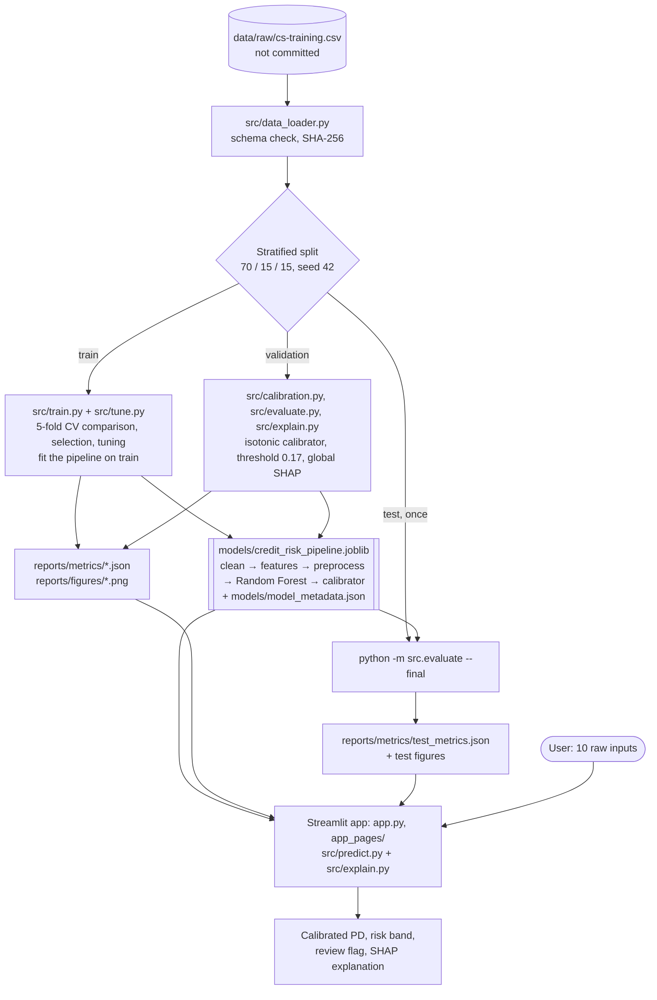

The deployed model is **one artifact**: a scikit-learn pipeline (cleaning →
feature engineering → preprocessing → Random Forest) wrapped in an isotonic
calibrator. It takes the 10 raw columns and returns a calibrated PD. The app
and the final evaluation load it as is, so training and serving share the
same code path.

## Methodology

```text
data → cleaning → feature engineering → baseline → ensemble models → tuning
     → calibration → threshold → evaluation → SHAP → application
```

1. **Data:** schema validation, hashing, and the stratified 70/15/15 split
   (above).
2. **EDA** on the training split only.
3. **Cleaning and feature engineering:** stateless transformers in the
   pipeline.
4. **Baseline:** Logistic Regression with model-specific preprocessing.
5. **Ensemble models:** Random Forest and XGBoost; an imbalance-strategy
   comparison (none vs class weights / `scale_pos_weight`); selection by
   validation PR-AUC.
6. **Tuning:** `RandomizedSearchCV` on training CV only.
7. **Calibration:** on validation; sigmoid vs isotonic by out-of-fold Brier.
8. **Threshold:** minimise expected cost on validation.
9. **Evaluation:** the one-time test evaluation with bootstrap CIs.
10. **SHAP:** global (validation sample) and local (per prediction).
11. **Application:** Streamlit, loading the artifact and reports only.

### Exploratory data analysis

Done on the **training split only**, so the validation and test sets don't
influence any decision. The full analysis is in
[`notebooks/01_eda.ipynb`](notebooks/01_eda.ipynb), Part 2.


**Main findings**

- **Past-due history is the strongest signal:** 2.8% default with no
  past-due events vs 51% with four or more.
- **Utilization rises steadily** from 1.8% (≤ 0.1) to 19% (0.9–1), then jumps
  to 39% just above the credit limit.
- **Age declines monotonically:** 11.6% under 30 vs 2.3% at 70+.
- **Income** has a mild effect (9.3% → 4.6% from the lowest to the highest
  octile). Debt ratio only matters above about 0.5.
- **Open credit lines and real-estate loans** have U-shaped relationships,
  which a linear model cannot capture.
- **Missing or zero income** comes with lower default rates (5.6% / 4.2% vs
  7.0%), partly because those borrowers are older.

### Cleaning & feature engineering

Implemented as two stateless scikit-learn transformers in
[`src/feature_engineering.py`](src/feature_engineering.py). They form the
first steps of every model pipeline, so training and the app apply exactly
the same logic. No rows are removed; invalid values become missing.

| Cleaning rule | Why |
|---|---|
| Past-due counts ≥ 90 → missing | 96/98 are codes, not counts |
| `age` < 18 → missing | Data error (one row with age 0) |
| `MonthlyIncome` = 0 → missing | The debt ratio was never computed for these rows |
| `DebtRatio` → missing when income is missing | It holds a debt amount there, not a ratio |
| Utilization > 10 → missing | Amount-like values, not plausible ratios |

| Engineered feature | Definition |
|---|---|
| `total_past_due` | Sum of the three past-due counts (missing if any count is missing) |
| `income_per_dependent` | `MonthlyIncome / (NumberOfDependents + 1)` |
| `utilization_over_limit` | 1 if utilization > 1, else 0 (missing if utilization is missing) |

Not built, because the training-split screening showed no added signal or
redundancy: `ever_90_days_late`, `monthly_income_missing`,
`estimated_monthly_debt`, `non_real_estate_lines`. The reasons for each
decision are in [`DECISIONS.md`](DECISIONS.md), Phase 3.

### Model-specific preprocessing

[`src/preprocessing.py`](src/preprocessing.py) adds the last step before each
model. All statistics are learned inside the pipeline, from training data only.

| Model | Preprocessing |
|---|---|
| Logistic Regression | Median imputation → winsorizing at the 1st/99th percentile → `log1p` for skewed features → standard scaling. Four missing-value indicators (income, dependents, past-due codes, utilization) bypass winsorizing |
| Random Forest | None: native missing-value support keeps the informative missingness |
| XGBoost | None: native missing-value handling |

## Results

### Model comparison and selection

All numbers come from `python -m src.train` and are saved in
`reports/metrics/model_comparison.json`. Cross-validation is stratified 5-fold
on the training split; "Val" is the validation split. The test set was not
used for any of these choices.

| Model | Imbalance handling | CV PR-AUC (mean ± std) | Val PR-AUC | Val ROC-AUC | Brier (raw) | Brier (calibrated) | Mean predicted PD | Train time |
|---|---|---|---|---|---|---|---|---|
| Logistic Regression | none | 0.383 ± 0.016 | 0.399 | 0.865 | 0.0494 | 0.0495 | 6.7% | 0.5 s |
| Logistic Regression | class weights | 0.380 ± 0.016 | 0.397 | 0.865 | 0.1439 | 0.0495 | 33.5% | 0.5 s |
| Random Forest (selected) | none | 0.390 ± 0.013 | 0.405 | 0.865 | 0.0491 | 0.0504 | 6.8% | 19.6 s |
| Random Forest | class weights | 0.386 ± 0.011 | 0.399 | 0.865 | 0.1098 | 0.0496 | 25.8% | 13.3 s |
| XGBoost | none | 0.387 ± 0.015 | 0.399 | 0.868 | 0.0492 | 0.0509 | 6.7% | 3.1 s |
| XGBoost | `scale_pos_weight` | 0.381 ± 0.013 | 0.401 | 0.863 | 0.1297 | 0.0498 | 29.5% | 3.2 s |
| **Random Forest, tuned (deployed)** | **none** | **0.393 ± 0.014** | **0.412** | **0.869** | **0.0488** | **0.0501** | **6.7%** | **15.7 s** |

- **Calibrated Brier** in this table is the selection tie-break measure: a
  sigmoid calibrator scored out-of-fold within the validation split. The
  deployed model's calibration is compared separately below.
- **Train time** is one fit on the training split from the run that wrote the
  report. It varies by a few seconds between runs.
- **The observed default rate** is 6.7%.

- **Reweighting never helped.** It didn't improve ranking for any model and
  inflated predicted probabilities 4–5×, so every model is trained without it.
- **Selected: Random Forest**, by the specification's rule (highest
  validation PR-AUC; models within 0.005 count as tied). Its lead of 0.006 is
  small: a bootstrap shows the three models are practically equivalent on
  ranking.
- **Tuning** (`RandomizedSearchCV`, 30 configurations × 5 folds on the
  training split). The best Random Forest uses 300 trees, maximum depth 20,
  at least 20 rows per leaf, 30% of features per split and 80% bootstrap
  samples. CV PR-AUC rose from 0.390 to 0.393. That gain is smaller than the
  fold-to-fold variation, and many configurations scored almost the same.
  The tuned model is also smaller (15 MB compressed). Details are in
  `reports/metrics/tuning_results.json`.

### Calibration

Calibration is fitted on the **validation split only**, around the frozen
Random Forest fitted on the training split. Sigmoid and isotonic were
compared by out-of-fold Brier score (5 folds within the validation split).
The rule, fixed beforehand, keeps sigmoid unless isotonic is at least 1%
better. Results are in `reports/metrics/calibration_results.json`.

| Probabilities | Brier | PR-AUC | Mean predicted PD |
|---|---|---|---|
| Raw Random Forest | 0.04879 | 0.412 | 6.73% |
| Sigmoid | 0.05014 | 0.411 | 6.68% |
| **Isotonic (deployed)** | **0.04881** | 0.401 | 6.68% |

The observed default rate is 6.68%. Isotonic was chosen (2.7% better than
sigmoid). The raw forest was already well calibrated, so calibration mainly
corrects the average. Isotonic calibration outputs a step function, so the
deployed model produces only about 60 distinct PD values. That costs some
ranking detail (PR-AUC 0.412 → 0.401). See `DECISIONS.md`, Phase 9.

### Decision threshold

The threshold minimises `5 × missed defaults + 1 × false alarms` on calibrated
validation PDs. **These costs are illustrative assumptions, not banking
figures:** a missed defaulter is assumed to cost five times as much as a
false alarm. The chosen threshold is **0.17**, close to the theoretical
1 / (1 + 5) ≈ 0.167 for well-calibrated probabilities. It is recorded in
`models/model_metadata.json`.

| Threshold | Precision | Recall | False alarms | Missed defaults | Cost |
|---|---|---|---|---|---|
| 0.10 | 0.249 | 0.743 | 3,369 | 386 | 5,299 |
| 0.15 | 0.322 | 0.621 | 1,967 | 570 | 4,817 |
| **0.17** | **0.326** | **0.614** | **1,910** | **581** | **4,815** |
| 0.20 | 0.386 | 0.519 | 1,243 | 723 | 4,858 |
| 0.30 | 0.507 | 0.342 | 500 | 989 | 5,445 |
| 0.50 | 0.574 | 0.275 | 306 | 1,091 | 5,761 |

At 0.17 the model flags 12.6% of validation borrowers, catches 61% of
defaulters, and has F1 0.43. Costs are almost flat from 0.14 to 0.17. The
full 0.05–0.95 table is in `reports/metrics/threshold_analysis.json`.


The **risk bands** (Low < 10% ≤ Medium < 30% ≤ High) are a separate,
descriptive display aid with illustrative boundaries. Only the threshold
defines the review flag.

### Final test evaluation

The saved model was evaluated on the held-out **test split (22,500 rows,
1,504 defaults) exactly once**, with `python -m src.evaluate --final`, after
every modelling choice had been fixed. The command checks that the data file
and the test split's row IDs match the ones recorded at training time. It
refuses to run a second time unless `--force` is given, and no forced re-run
has happened. Results are in `reports/metrics/test_metrics.json`.

**Final test table** (Random Forest, tuned, isotonic calibration; 95%
bootstrap confidence intervals from 1,000 resamples)

| Metric | Deployed model (calibrated) | Raw Random Forest | Validation reference |
|---|---|---|---|
| **PR-AUC** (primary) | **0.392** [0.367, 0.418] | 0.411 [0.384, 0.440] | 0.401 (calibrated, out-of-fold) |
| ROC-AUC | 0.869 [0.860, 0.879] | 0.870 [0.860, 0.880] | 0.869 (raw) |
| Brier score | 0.0486 [0.0466, 0.0507] | 0.0485 [0.0465, 0.0506] | 0.0488 (calibrated, out-of-fold) |
| Mean predicted PD | 6.64% | 6.70% | observed on test: 6.68% |

**At the decision threshold 0.17** (calibrated PD; illustrative costs
5 × missed default + 1 × false alarm):

| Precision | Recall | F1 | Flagged | Expected cost |
|---|---|---|---|---|
| 0.334 | 0.621 | 0.434 | 12.4% | 4,713 |

|  | Not flagged | Flagged for review |
|---|---|---|
| **No default** | 19,133 (TN) | 1,863 (FP) |
| **Default** | 570 (FN) | 934 (TP) |

On validation, the same threshold gave precision 0.326 and recall 0.614, so
the operating point carried over to unseen data.

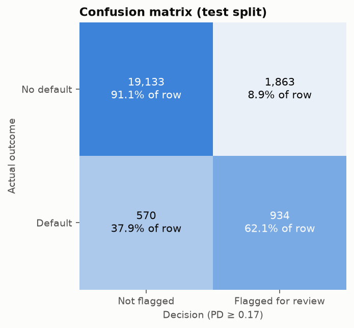

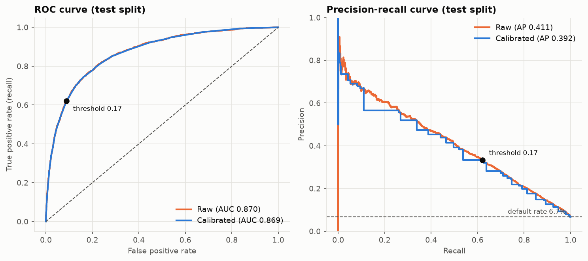

**Calibration on test.** Predicted PDs match observed default rates closely
across the whole range, both raw and calibrated. Within each risk band the
average PD matches the observed rate:

| Risk band | Share of borrowers | Mean predicted PD | Observed default rate |
|---|---|---|---|
| Low (< 10%) | 80.0% | 2.2% | 2.1% |
| Medium (10–30%) | 15.6% | 17.3% | 17.3% |
| High (≥ 30%) | 4.4% | 50.3% | 51.8% |

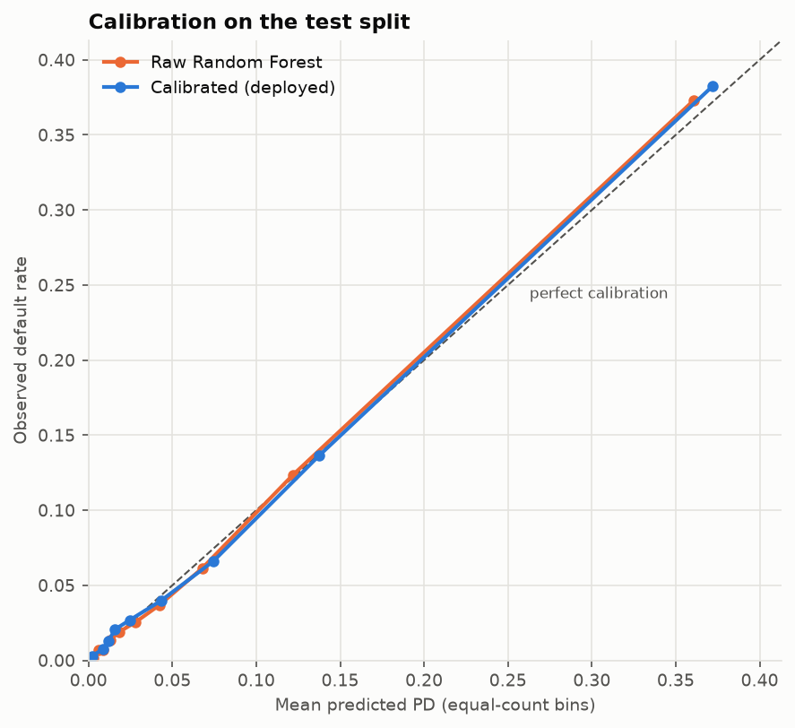

**What the test results show**

- **Performance held up.** The raw model's test PR-AUC (0.411) is almost
  identical to its validation PR-AUC (0.412). Every point estimate lies
  inside the test confidence intervals of the others, so there is no sign
  of overfitting to the validation split.
- **Isotonic calibration didn't help on test.** The raw forest was already
  well calibrated: its Brier score (0.0485) is no worse than the calibrated
  one (0.0486). The isotonic step function cost ranking detail: PR-AUC fell
  from 0.411 to 0.392, as validation had predicted (0.412 → 0.401). The
  method was chosen by a rule fixed before any results were seen. Changing
  it now would be a decision informed by the test set, so the deployed model
  keeps it. See `DECISIONS.md`, Phases 9 and 11.
- **The intervals are wide.** PR-AUC spans about ±0.026, which is larger than
  the differences between the candidate models. The choice of Random Forest
  over XGBoost or Logistic Regression is a reasonable one, not a proven one.

## Explainability (SHAP)

[`src/explain.py`](src/explain.py) takes the Random Forest back out of the
calibrated artifact and explains it with `shap.TreeExplainer`.

> **What the numbers mean.** SHAP explains the **uncalibrated** Random
> Forest. A Random Forest predicts a probability, not log-odds, so each
> contribution is in **percentage points of the uncalibrated PD**, and the
> contributions add up exactly to that PD. The calibrator is applied
> afterwards. It is monotonic, so it keeps the ranking and direction of each
> effect, but the contributions do not add up exactly to the calibrated PD
> that is displayed. (XGBoost or Logistic Regression would be explained in
> log-odds, as SPEC §13.1 assumes; the code supports both. See `DECISIONS.md`,
> Phase 10.)

**Global explanation.** SHAP values were computed for a stratified sample of
**2,000 validation rows** (seed 42, 134 defaults, 6.7%). The test set is not
used. Results are in `reports/metrics/shap_global.json`, including a hash of
the sampled row IDs.

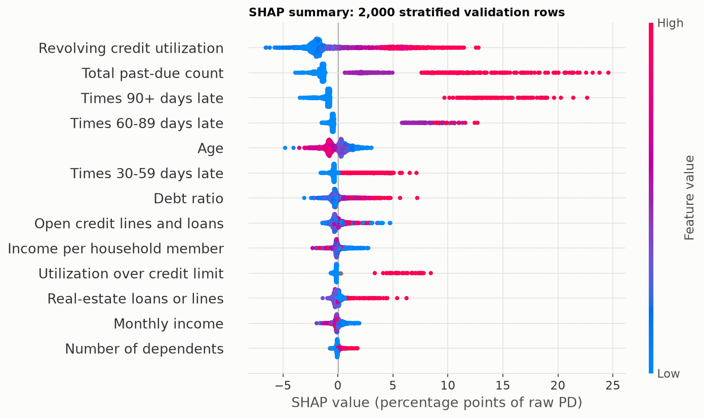

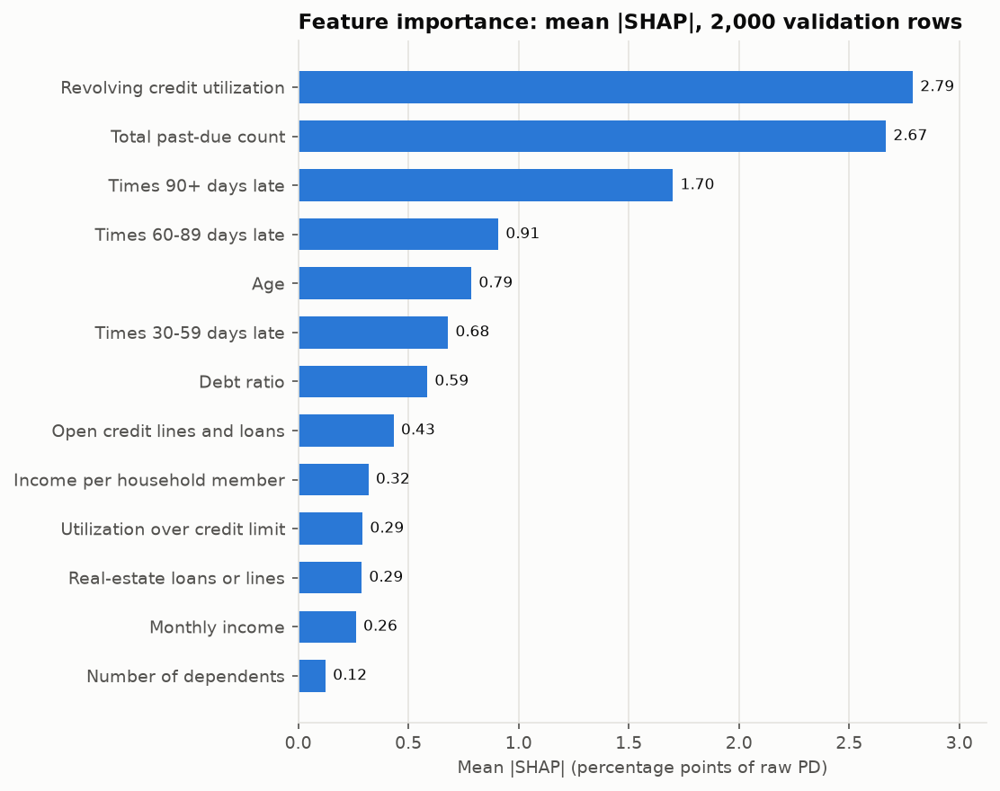

| Rank | Feature | Mean \|SHAP\| (pp) | Higher value → |
|---|---|---|---|
| 1 | Revolving credit utilization | 2.79 | higher risk |
| 2 | Total past-due count | 2.67 | higher risk |
| 3 | Times 90+ days late | 1.70 | higher risk |
| 4 | Times 60–89 days late | 0.91 | higher risk |
| 5 | Age | 0.79 | lower risk |

Direction is the sign of the rank correlation between a feature's value and
its SHAP value in the sample. Past-due history and utilization dominate, as
the EDA suggested. Income-related features rank near the bottom.

**Local explanation (example prediction).** For a single prediction,
`explain_row` returns the calibrated PD, the risk band, and every feature's
input value and SHAP contribution. `format_local_explanation` lists the top 3
factors that increase risk and the top 3 that reduce it. The text is built
only from SHAP values and input values.

The example below is for an **invented borrower**, not a row from the
dataset, so no real Kaggle records are published. Its inputs are
`SHAP_EXAMPLE_BORROWER` in `src/config.py`: utilization 1.05, age 52, twice
30–59 days late, never 60+ days late, debt ratio 0.35, income 5,200, 8 open
lines, 1 real-estate loan, 1 dependent.

```text
Probability of Default: 29.7%   (Risk band: MEDIUM)

Factors increasing risk:
- Total past-due count: 2              (+10.9 pp)
- Revolving credit utilization: 1.05   (+10.8 pp)
- Utilization over credit limit: Yes   (+7.6 pp)

Factors reducing risk:
- Times 90+ days late: 0     (-2.3 pp)
- Times 60-89 days late: 0   (-1.3 pp)
- Debt ratio: 0.35           (-0.8 pp)
```

Its uncalibrated PD is 34.4%. The SHAP contributions add up to that value,
and the calibrator maps it to the 29.7% shown. With a PD of 29.7%, this
borrower is above the 0.17 threshold and would be **flagged for manual
review**.

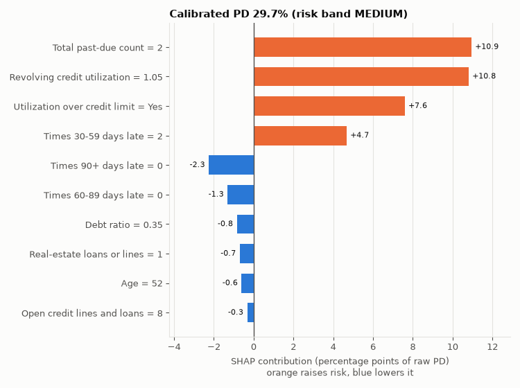

Input values are shown after cleaning. For example, a past-due code of 98
appears as "Unknown", which is what the model actually saw.

## Leakage audit

Answers to the SPEC §20 questions, with evidence.

| Question | Answer | Evidence |
|---|---|---|
| Was the target used in any feature? | **No.** | `CleaningTransformer` selects the 10 raw features by name, so the target and row ID are dropped before any feature is built; the engineered features use raw features only ([`src/feature_engineering.py`](src/feature_engineering.py)). Test: `test_target_and_id_never_reach_features`. |
| Were imputation, scaling or capping statistics computed on anything other than training data or training folds? | **No.** | Every learned statistic (median imputation, winsorizing bounds, scaling) sits inside the model pipeline ([`src/preprocessing.py`](src/preprocessing.py)), so CV refits it on each training fold and the final model learns it from the training split only. The cleaning rules are fixed thresholds in `config.py`, not learned. The deployed Random Forest has no learned preprocessing. Tests: `test_logistic_statistics_come_from_fit_data_only`, `test_clipper_uses_bounds_learned_in_fit_only`, and a stateless check in `test_features.py`. |
| Was SMOTE applied outside training folds? | **Not used.** | SMOTE is optional in the SPEC and was not run. Class weights and `scale_pos_weight` were compared inside CV, and no reweighting was chosen (`DECISIONS.md`, Phase 7). The `scale_pos_weight` ratio came from the training split; stratified folds keep it identical. |
| Was any feature selection done? | **No.** | All 10 raw features are used. Three engineered features were designed by hand from the training-split EDA (univariate screening on train only, `DECISIONS.md` Phase 3). No automated selection was run on any split. |
| Was the validation or test set used during hyperparameter tuning? | **No.** | `RandomizedSearchCV` ran on stratified 5-fold CV of the training split ([`src/tune.py`](src/tune.py)). Whether to keep the tuned configuration was decided by CV PR-AUC alone; validation scores were only reported. Tests run the stages with an unusable test split: `test_candidates_never_touch_test_split`, the tuning tests. |
| Was the calibrator fitted on validation data only? | **Yes.** | `CalibratedClassifierCV(FrozenEstimator(pipeline))` is fitted on the validation split ([`src/calibration.py`](src/calibration.py)). The sigmoid/isotonic comparison used 5-fold out-of-fold calibration within validation. The pipeline itself was fitted on train and never refitted. Test: `test_calibrator_wraps_frozen_pipeline_and_is_monotone`. |
| Was the decision threshold chosen on validation data only? | **Yes.** | `choose_threshold` uses calibrated validation PDs ([`src/train.py`](src/train.py), `run_calibration_and_threshold`). Caveat: these are PDs from a calibrator fitted on the same rows, so the cost is slightly optimistic (+1.8% out-of-fold, `DECISIONS.md` Phase 9). The test set played no part. |
| Was EDA-driven decision-making restricted to the training split? | **Yes.** | Part 2 of [`notebooks/01_eda.ipynb`](notebooks/01_eda.ipynb), where every target-related analysis and every new cleaning or feature decision happens, uses the training split only. Part 1 reports structural facts about the whole file (shape, codes, missingness) without relating anything to the target. The cleaning rules it confirmed were fixed in the SPEC beforehand. |
| Was the test set evaluated exactly once? Any `--force` re-run? | **Once, no re-run.** | `python -m src.evaluate --final` ran once (2026-10-10 21:57 UTC); `test_metrics.json` records `"forced_rerun": false`. The command refuses to run again without `--force` (tests in `test_final_evaluation.py`). Later presentation fixes did not re-score the test set (`DECISIONS.md`, Phase 11). Apart from the three `test_*.png` figures, every figure uses training data (EDA) or validation data (threshold, SHAP). |
| Are any features recorded after the outcome period? | **None known.** | According to the competition's description, the features describe the borrower at the time the data was recorded (past-due counts look back over previous years), while the target covers the following two years. The data has no timestamps, so this cannot be verified row by row; it is a limitation of the dataset. |

Two further points:
- **Duplicates across splits:** 129 test rows (0.6%) share a feature profile
  with a training row. These are kept as genuine identical borrowers, and
  their effect on test metrics is negligible (`split_summary.json`).
- **Test split access:** every stage creates the same seeded split. Apart
  from the split summary (row counts, default rate, row-ID hash), only
  `python -m src.evaluate --final` reads the test rows.

## Application

```powershell
streamlit run app.py
```

The app opens at `http://localhost:8501`. It **only loads** the saved model
(`models/`) and reports (`reports/`). It never trains a model, never reads the
raw dataset and never touches the test set. Tests check this by making any
attempt to load the dataset fail.

| Page | Contents |
|---|---|
| **Home** | What the model predicts, the exact target definition, headline test results with confidence intervals, why PR-AUC, key limitations |
| **Prediction** | A form with the 10 raw features → calibrated PD, risk band, review flag, and the local SHAP explanation |
| **Model performance** | Final test metrics with confidence intervals; ROC/PR curves, confusion matrix, calibration and threshold plots; the model comparison |
| **Explainability** | Global SHAP plots and feature ranking, with the note on what SHAP explains |
| **About and limitations** | Dataset limitations and responsible-use notes (bias, age, proxies, dataset shift, error costs, human oversight) |

**Prediction page:**

- The form is built from the feature list in `model_metadata.json`, in the
  same order. The input rules live in
  [`src/predict.py`](src/predict.py).
- **Hard limits:** no negative values, and age must be 18–110. Past-due
  counts are capped at 89, because 96 and 98 are dataset codes, not counts.
- **Unknown values:** income and dependents each have an **Unknown**
  checkbox, which sends a missing value. When income is unknown, the debt
  ratio field is disabled, because the model ignores it in that case.
- **Warnings:** the app warns when an input lies outside the training data's
  1st–99th percentile range ("the prediction may be less reliable"). It also
  notes inputs the model treats as unknown: an income of 0, or a
  utilization above 10.
- **Output:** the calibrated PD, the risk band, and whether the borrower is
  flagged for manual review (PD ≥ 0.17). Below that, the top 3 factors
  raising and lowering risk, and a chart of the 10 largest SHAP
  contributions. A one-sentence note explains that the contributions are for
  the uncalibrated model and do not add up exactly to the PD shown.
- A result is shown only for the inputs it was computed from. If any input
  changes, the app asks for a new prediction.
- **Version check:** the app shows a warning if the installed library
  versions differ from those recorded in the metadata.

**Screenshots** (taken manually, SPEC §23):

| Home | Prediction |
|---|---|
| 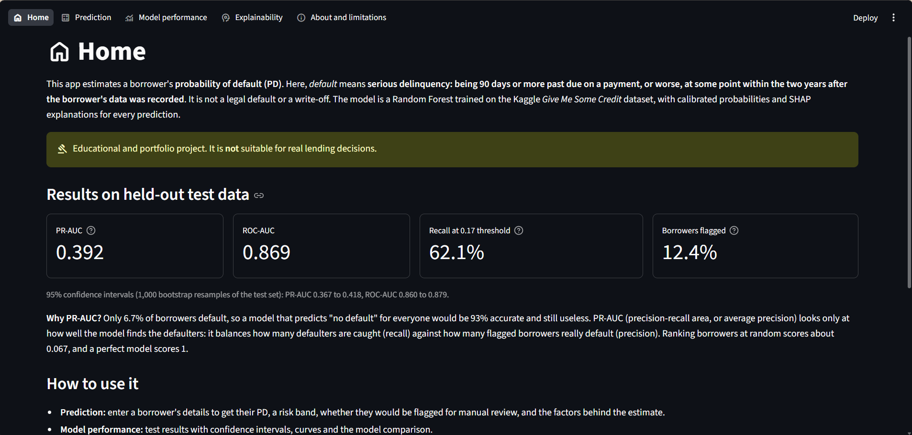 | 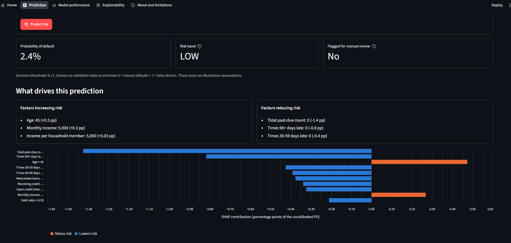 |

| Model performance | Explainability |
|---|---|
| 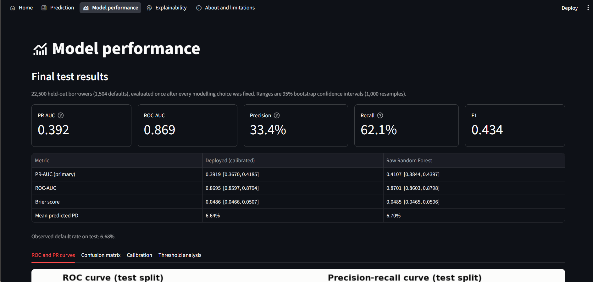 | 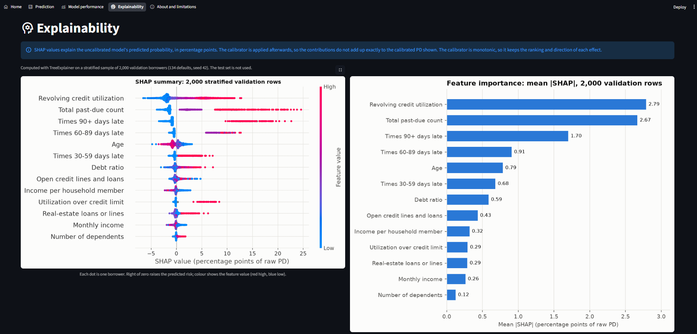 |

Deployment target: local (`streamlit run app.py`). Streamlit Community Cloud
is optional and has not been set up.

## Limitations and responsible ML

**Model and data limitations**

- **Old data from an unknown population:** the dataset dates from around
  2011, and the lender, country and borrower selection are undocumented.
  Only approved borrowers are included, so rejected applicants are missing
  (selection bias). There are no loan details (amount, purpose, term,
  collateral).
- **Modest ranking power:** PR-AUC 0.392 against a base rate of 0.067. The
  model concentrates risk well (the High band defaults at 52%), but at the
  chosen threshold two out of three flagged borrowers do not default.
- **Calibration choice:** isotonic calibration was selected by a pre-set
  rule but did not improve on the raw model and costs ranking detail (see
  Results). PDs come in steps, so similar borrowers can share the same PD.
- **Uncertainty:** the confidence intervals are wide relative to the
  differences between model families.
- **Runtime:** a from-scratch run with `--retune` takes about 34 minutes on a
  6-core laptop, slightly above the SPEC's 30-minute target (`DECISIONS.md`,
  Phases 8 and 10).

**Responsible ML (SPEC §21)**

- **Historical bias:** the model learns from past lending outcomes, which can
  reflect past unequal treatment. It reproduces those patterns rather than
  correcting them.
- **Demographic bias and age:** `age` is a protected attribute in many
  lending regulations. It is used because it is one of the dataset's source
  features, and it ranks 5th of 13 features by mean |SHAP|: older borrowers
  receive lower PDs. A real deployment would need legal review and possibly
  a model without age. The optional fairness experiments (a variant without
  `age`, metrics by age band) were **not** run, so no fairness claim is made.
- **Proxy variables:** even without protected attributes, features such as
  income, dependents or real-estate loans can act as proxies for them.
- **Dataset shift:** the PD is reliable only for borrowers similar to the
  2011-era training data. The app warns when inputs fall outside the training
  range, but cannot detect a changed population or economy.
- **Costs of errors:** the threshold assumes a missed defaulter costs 5× a
  false alarm. These are illustrative numbers. Different costs move the
  threshold, and the trade-off is shown in the threshold table.
- **Interpretability:** SHAP shows which inputs moved a prediction for this
  model. It describes model behaviour, not causes, and it explains the
  uncalibrated model.
- **Human oversight:** the output is a **flag for manual review**, not a
  decision. A person should make, and be accountable for, any credit
  decision.

## Future improvements

- **Monitoring:** track input drift (for example the population stability
  index per feature), the predicted PD distribution, and the flag rate
  against the 12.4% seen on test. Once outcomes mature, track calibration
  and PR-AUC on new cohorts.
- **External validation:** evaluate on newer data or another lender's
  portfolio before any real use, and re-check calibration there.
- **Model versioning:** register each artifact with its metadata, data hash
  and metrics (for example in MLflow), and keep the test evaluation tied to
  one artifact version.
- **Fairness experiments (optional in the SPEC):** train a variant without
  `age` and compare metrics, and report performance and calibration by age
  band, without claiming fairness from similar group metrics.
- **Calibration choice:** include "no calibration" and a log-odds sigmoid
  among the pre-registered options, since the raw forest was already well
  calibrated.
- **Faster training:** parallelise the tuning search differently, or cache
  more stages, to bring a full `--retune` run under 30 minutes.
- **Engineering:** run `pytest` in CI (for example GitHub Actions) on every
  push; optionally deploy the app to Streamlit Community Cloud.

## Commands

```powershell
python -m src.data_loader           # validate the data file and write the split summary
python -m src.train                 # compare, select, tune, calibrate, save, global SHAP (about 9 min when the cached search is reused)
python -m src.train --retune        # also re-run the hyperparameter search (about 34 min on a 6-core laptop)
python -m src.train --from-phase 9  # only calibration, threshold, saving and global SHAP, reusing the saved Phase 6-8 results (about 4.5 min)
python -m src.explain               # only global SHAP for the saved model; no training (about 4 min)
streamlit run app.py                # the app
```

`--from-phase 9` leaves the Phase 6–8 reports unchanged. It refits the
saved final configuration on the training split and stops if the refit
does not exactly reproduce the saved validation PR-AUC, or if the data, search
or library versions have changed.

The test split is never used by training. It is used only by the one-time
final evaluation:

```powershell
python -m src.evaluate --final          # ONE-TIME test evaluation (refuses to run again)
python -m src.evaluate --final --force  # re-run only with a reason; record it in DECISIONS.md
```

## Tests

```powershell
pytest              # 226 tests, about 6-9 minutes on a laptop CPU
pytest -rs          # also list skipped tests and why
```

The suite **does not need the Kaggle file or the trained model**. Tests use a
generated synthetic dataset
([`tests/fixtures/make_synthetic_data.py`](tests/fixtures/make_synthetic_data.py)).
It has the real file's schema and its data problems: missing income and
dependents, 96/98 codes, zero income, zero dependents, age 0, and implausible
utilization. Tests that need a model train a small one on that data
([`make_synthetic_artifact.py`](tests/fixtures/make_synthetic_artifact.py)).
Every test that writes output uses temporary folders, so running the suite
never changes `models/` or `reports/`.

Six tests use the real trained model or reports. They are **skipped** when
those files are absent (9 skips, counting parameterized cases). Both
situations were checked on a clean export of the repository:

| Situation | Result |
|---|---|
| No Kaggle file (fresh clone) | 226 passed |
| No Kaggle file, no model, no reports | 217 passed, 9 skipped |

| Test file | Covers |
|---|---|
| `test_data.py` | Schema validation (missing or extra columns), binary target, ID column dropped, split reproducibility |
| `test_features.py` | Cleaning rules (96/98 codes, age < 18, zero income, utilization), each engineered feature, no `inf`, target never a feature |
| `test_preprocessing.py` | Statistics learned from training data only, missing indicators, probabilities in [0, 1] |
| `test_train.py`, `test_tune.py`, `test_resume.py` | Selection and imbalance rules, tuning cache, `--from-phase 9`; the test split is never touched |
| `test_calibration.py` | Calibration rule, threshold choice, saved artifact |
| `test_explain.py` | SHAP additivity (RF, XGBoost, LR), local and global explanations, the invented example borrower |
| `test_final_evaluation.py` | One-time test evaluation: refusal to re-run, data and split checks, bootstrap intervals |
| `test_predict.py` | Input limits, warnings, PD, band and flag, NaN income and dependents |
| `test_app.py` | Every app page (headless `AppTest`), form fields match the metadata in order, the end-to-end prediction, no access to the raw data |

## Repository structure

```text
.
├── app.py                      # Streamlit entry point (st.navigation)
├── app_pages/                  # Home, Prediction, Model performance, Explainability, About
├── app_support.py              # cached loaders for the app (model, reports)
├── data/raw/                   # cs-training.csv goes here (git-ignored)
├── models/
│   ├── credit_risk_pipeline.joblib   # the single artifact: pipeline + calibrator
│   └── model_metadata.json           # features, threshold, bands, percentiles, hashes, versions
├── notebooks/01_eda.ipynb      # EDA (Part 1: whole file, structure only; Part 2: training split)
├── reports/
│   ├── figures/                # EDA, threshold, SHAP, test and app_* screenshot figures
│   └── metrics/                # split, comparison, tuning, calibration, threshold, SHAP, test JSON
├── src/
│   ├── config.py               # paths, seed, schema, cleaning thresholds, labels, bands, costs
│   ├── data_loader.py          # load, validate schema, hash, split
│   ├── feature_engineering.py  # CleaningTransformer, FeatureEngineer
│   ├── preprocessing.py        # per-model preprocessing and the full pipeline
│   ├── train.py                # entry point: comparison, selection, tuning, calibration, artifact
│   ├── tune.py                 # randomized search spaces and the search
│   ├── calibration.py          # calibrator fitting and the sigmoid/isotonic comparison
│   ├── evaluate.py             # metrics, threshold analysis, one-time --final test evaluation
│   ├── explain.py              # SHAP: unwrapping, global and local explanations
│   └── predict.py              # app-facing prediction: validation, PD, band, flag, explanation
├── tests/                      # pytest suite + synthetic fixtures (no real data)
├── DECISIONS.md                # decision log, phase by phase
├── SPEC.md                     # project specification
└── requirements.txt            # pinned direct dependencies (Python 3.12)
```
