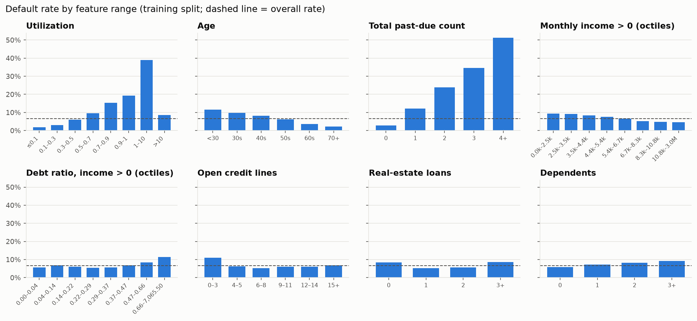
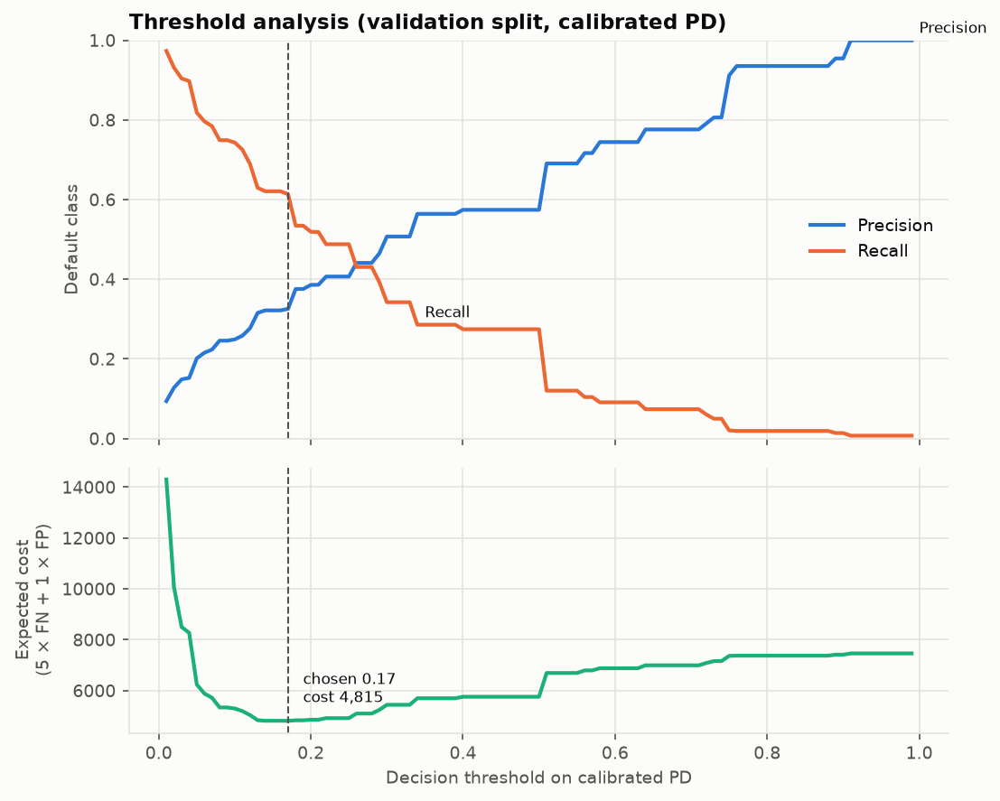

# Credit Risk Prediction & Explainable Default Probability System

> **Status: in development (Phase 9 — calibration, decision threshold and model artifact complete).** Results,
> figures and the full write-up are added as later phases are completed. See
> [`SPEC.md`](SPEC.md) for the full specification and
> [`DECISIONS.md`](DECISIONS.md) for the decisions made so far.

An educational/portfolio project that estimates the probability that a
borrower becomes seriously delinquent (90+ days past due) within two years,
using the Kaggle *Give Me Some Credit* dataset. It is **not** suitable for
real lending decisions.

## Setup (Windows PowerShell)

```powershell
py -3.12 -m venv .venv
.venv\Scripts\Activate.ps1
# If activation is blocked:  Set-ExecutionPolicy -Scope CurrentUser RemoteSigned
pip install -r requirements.txt
```

## Dataset

The data is downloaded manually because Kaggle requires an account:

1. Sign in to Kaggle and accept the rules of the
   [Give Me Some Credit](https://www.kaggle.com/c/GiveMeSomeCredit) competition.
2. Download `cs-training.csv`. (`cs-test.csv` has no labels and is not used.)
3. Place it at `data/raw/cs-training.csv`.

The raw data is not committed to this repository. To validate the file and
reproduce the split:

```powershell
python -m src.data_loader
```

### Overview

| Property | Value |
|---|---|
| Rows | 150,000 |
| Features | 10 numeric features (plus a row ID, used only as the index) |
| Target | `SeriousDlqin2yrs` → renamed `default`: 90+ days past due within 2 years |
| Class balance | 10,026 defaults (**6.68%**) vs 139,974 non-defaults |
| SHA-256 | `1bd46da486a5708c58c7b01a034fae2a13b327f6f7b62ea7ba4fe3b5824b24ac` |

| Feature | Meaning |
|---|---|
| `RevolvingUtilizationOfUnsecuredLines` | Revolving credit utilization |
| `age` | Borrower age |
| `NumberOfTime30-59DaysPastDueNotWorse` | Times 30–59 days late |
| `NumberOfTime60-89DaysPastDueNotWorse` | Times 60–89 days late |
| `NumberOfTimes90DaysLate` | Times 90+ days late |
| `DebtRatio` | Monthly debt payments / monthly income |
| `MonthlyIncome` | Monthly income |
| `NumberOfOpenCreditLinesAndLoans` | Open credit lines and loans |
| `NumberRealEstateLoansOrLines` | Real-estate loans or lines |
| `NumberOfDependents` | Number of dependents |

### Data quality findings

Details are in [`notebooks/01_eda.ipynb`](notebooks/01_eda.ipynb), Part 1.

- **Missing values:** `MonthlyIncome` 19.82% and `NumberOfDependents` 2.62%.
  Every row missing dependents is also missing income.
- **Special codes:** 269 rows have the values 96 or 98 in all three past-due
  columns. These are codes, not real counts (the largest genuine count is
  17), and are treated as missing.
- **Invalid age:** one row has age 0 and is treated as missing. Ages 101–109
  (13 rows) are kept.
- **Debt ratio:** when income is missing or zero, `DebtRatio` appears to hold
  a raw debt amount (median about 1,000) rather than a ratio (median 0.29).
- **Utilization:** 3,321 rows exceed 1.0; the maximum is 50,708.
- **Duplicates:** 609 duplicate rows, mostly thin-file profiles (about one
  credit line, low or missing income), are kept as genuinely identical
  borrowers (see `DECISIONS.md`).

### Data split

Stratified, with seed 42 (details in `reports/metrics/split_summary.json`):

| Split | Rows | Defaults | Used for |
|---|---|---|---|
| Train | 105,000 | 7,018 (6.68%) | Model fitting and cross-validated tuning |
| Validation | 22,500 | 1,504 (6.68%) | Model selection, calibration, threshold choice |
| Test | 22,500 | 1,504 (6.68%) | Final evaluation, once |

## Exploratory data analysis

Done on the **training split only**, so the validation and test sets don't
influence any decision. The full analysis is in
[`notebooks/01_eda.ipynb`](notebooks/01_eda.ipynb), Part 2.



**Main findings**

- **Past-due history is the strongest signal:** 2.8% default with no
  past-due events vs 51% with four or more.
- **Utilization rises steadily** from 1.8% (≤ 0.1) to 19% (0.9–1), then jumps
  to 39% just above the credit limit.
- **Age declines monotonically:** 11.6% under 30 vs 2.3% at 70+.
- **Income** has a mild effect (9.3% → 4.6% from the lowest to the highest
  octile). Debt ratio only matters above about 0.5.
- **Open credit lines and real-estate loans** have U-shaped relationships,
  which a linear model cannot capture.
- **Missing or zero income** comes with lower default rates (5.6% / 4.2% vs
  7.0%), partly because those borrowers are older.

**Decisions this feeds into**

| Area | Decision |
|---|---|
| Cleaning | Past-due codes 96/98 → missing; age < 18 → missing; **income 0 → missing**; **debt ratio → missing when income is missing** (it holds a debt amount there, not a ratio); **utilization > 10 → missing** (implausible, amount-like values) |
| New features | `total_past_due`, `income_per_dependent`, `utilization_over_limit` |
| Not built | `ever_90_days_late`, `monthly_income_missing`, `estimated_monthly_debt`, `non_real_estate_lines` (no added signal or redundant) |

Reasons for each decision are in [`DECISIONS.md`](DECISIONS.md).

## Cleaning & feature engineering

Implemented as two stateless scikit-learn transformers in
[`src/feature_engineering.py`](src/feature_engineering.py). They form the
first steps of every model pipeline, so training and the app apply exactly
the same logic. No rows are removed; invalid values become missing.

| Cleaning rule | Why |
|---|---|
| Past-due counts ≥ 90 → missing | 96/98 are codes, not counts |
| `age` < 18 → missing | Data error (one row with age 0) |
| `MonthlyIncome` = 0 → missing | The debt ratio was never computed for these rows |
| `DebtRatio` → missing when income is missing | It holds a debt amount there, not a ratio |
| Utilization > 10 → missing | Amount-like values, not plausible ratios |

| Engineered feature | Definition |
|---|---|
| `total_past_due` | Sum of the three past-due counts (missing if any count is missing) |
| `income_per_dependent` | `MonthlyIncome / (NumberOfDependents + 1)` |
| `utilization_over_limit` | 1 if utilization > 1, else 0 (missing if utilization is missing) |

## Model-specific preprocessing

[`src/preprocessing.py`](src/preprocessing.py) adds the last step before each
model. All statistics are learned inside the pipeline, from training data only.

| Model | Preprocessing |
|---|---|
| Logistic Regression | Median imputation → winsorizing at the 1st/99th percentile → `log1p` for skewed features → standard scaling. Four missing-value indicators (income, dependents, past-due codes, utilization) bypass winsorizing |
| Random Forest | None: native missing-value support keeps the informative missingness |
| XGBoost | None: native missing-value handling |

## Results so far

All numbers come from `python -m src.train` and are saved in
`reports/metrics/model_comparison.json`. Cross-validation is stratified 5-fold
on the training split; "Val" is the validation split. The test set has not
been used.

**Model comparison** (untuned models; PR-AUC is the primary metric)

| Model | Imbalance handling | CV PR-AUC | Val PR-AUC | Val ROC-AUC | Val Brier | Mean predicted PD | Fit time |
|---|---|---|---|---|---|---|---|
| Logistic Regression | none | 0.383 ± 0.016 | 0.399 | 0.865 | 0.049 | 6.7% | 0.4 s |
| Logistic Regression | class weights | 0.380 ± 0.016 | 0.397 | 0.865 | 0.144 | 33.5% | 0.5 s |
| **Random Forest** | **none** | **0.390 ± 0.014** | **0.405** | 0.865 | 0.049 | 6.8% | 12.8 s |
| Random Forest | class weights | 0.386 ± 0.011 | 0.399 | 0.865 | 0.110 | 25.8% | 9.5 s |
| XGBoost | none | 0.387 ± 0.015 | 0.399 | 0.868 | 0.049 | 6.7% | 2.4 s |
| XGBoost | `scale_pos_weight` | 0.382 ± 0.013 | 0.401 | 0.863 | 0.130 | 29.5% | 2.3 s |
| **Random Forest, tuned** | **none** | **0.393 ± 0.014** | **0.412** | **0.870** | **0.049** | 6.7% | 18.7 s |

The observed default rate is 6.7%.

- **Reweighting never helped.** It didn't improve ranking for any model and
  inflated predicted probabilities 4–5×, so every model is trained without it.
- **Selected: Random Forest**, by the specification's rule (highest
  validation PR-AUC; models within 0.005 count as tied). Its lead of 0.006 is
  small: a bootstrap shows the three models are practically equivalent on
  ranking.

**Tuning** (`RandomizedSearchCV`, 30 configurations × 5 folds on the training
split): the best Random Forest uses 300 trees, maximum depth 20, at least 20
rows per leaf, 30% of features per split and 80% bootstrap samples. CV PR-AUC
rose from 0.390 to 0.393. That gain is smaller than the fold-to-fold variation,
and many configurations scored almost the same. The tuned model is also smaller
(15 MB compressed). Details are in `reports/metrics/tuning_results.json`.

## Calibration and decision threshold

Both are chosen on the **validation split only**, around the frozen
Random Forest fitted on the training split. Results are in
`reports/metrics/calibration_results.json` and
`reports/metrics/threshold_analysis.json`.

**Calibration.** Sigmoid and isotonic calibration were compared by
out-of-fold Brier score (5 folds within the validation split). The rule,
fixed beforehand, keeps sigmoid unless isotonic is at least 1% better.

| Probabilities | Brier | PR-AUC | Mean predicted PD |
|---|---|---|---|
| Raw Random Forest | 0.04879 | 0.412 | 6.73% |
| Sigmoid | 0.05014 | 0.411 | 6.68% |
| **Isotonic (deployed)** | **0.04881** | 0.401 | 6.68% |

The observed default rate is 6.68%. Isotonic was chosen (2.7% better than
sigmoid). The raw forest was already well calibrated, so calibration mainly
corrects the average. Isotonic calibration outputs a step function, so the
deployed model produces only about 60 distinct PD values. That costs some
ranking detail (PR-AUC 0.412 → 0.401). See `DECISIONS.md`, Phase 9.

**Decision threshold.** The threshold minimises `5 × missed defaults + 1 × false
alarms` on calibrated validation PDs. **These costs are illustrative
assumptions, not banking figures.** The chosen threshold is **0.17**, close to
the theoretical 1 / (1 + 5) ≈ 0.167 for well-calibrated probabilities.

| Threshold | Precision | Recall | False alarms | Missed defaults | Cost |
|---|---|---|---|---|---|
| 0.10 | 0.249 | 0.743 | 3,369 | 386 | 5,299 |
| 0.15 | 0.322 | 0.621 | 1,967 | 570 | 4,817 |
| **0.17** | **0.326** | **0.614** | **1,910** | **581** | **4,815** |
| 0.20 | 0.386 | 0.519 | 1,243 | 723 | 4,858 |
| 0.30 | 0.507 | 0.342 | 500 | 989 | 5,445 |
| 0.50 | 0.574 | 0.275 | 306 | 1,091 | 5,761 |

At 0.17 the model flags 12.6% of validation borrowers, catches 61% of
defaulters, and has F1 0.43. Costs are almost flat from 0.14 to 0.17. The
full 0.05–0.95 table is in `threshold_analysis.json`.



**Saved model.** `models/credit_risk_pipeline.joblib` (15 MB) holds the whole
chain (cleaning → features → Random Forest → isotonic calibrator). It takes
the 10 raw input columns and returns a calibrated PD.
`models/model_metadata.json` records the threshold, calibration method,
hyperparameters, risk bands, training-data percentiles, data hash and library
versions.

## Training

```powershell
python -m src.train                 # compare, select, tune, calibrate, save (about 5 min when the cached search is reused)
python -m src.train --retune        # also re-run the hyperparameter search (about 30 min on a 6-core laptop)
python -m src.train --from-phase 9  # only calibration, threshold and saving, reusing the saved Phase 6-8 results (about 20 s)
```

`--from-phase 9` leaves the Phase 6–8 reports unchanged. It refits the
saved final configuration on the training split and stops if the refit
does not exactly reproduce the saved validation PR-AUC, or if the data, search
or library versions have changed.

The test split is never used by training.

## Tests

```powershell
pytest
```

The tests use generated synthetic data and do not need the Kaggle file.
